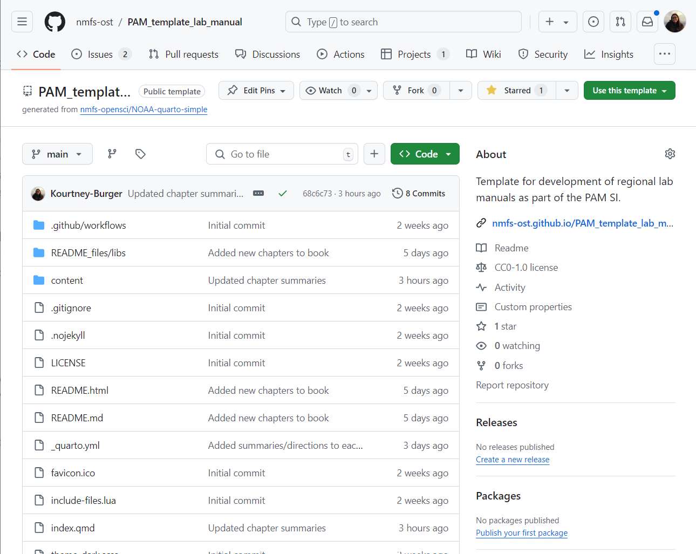
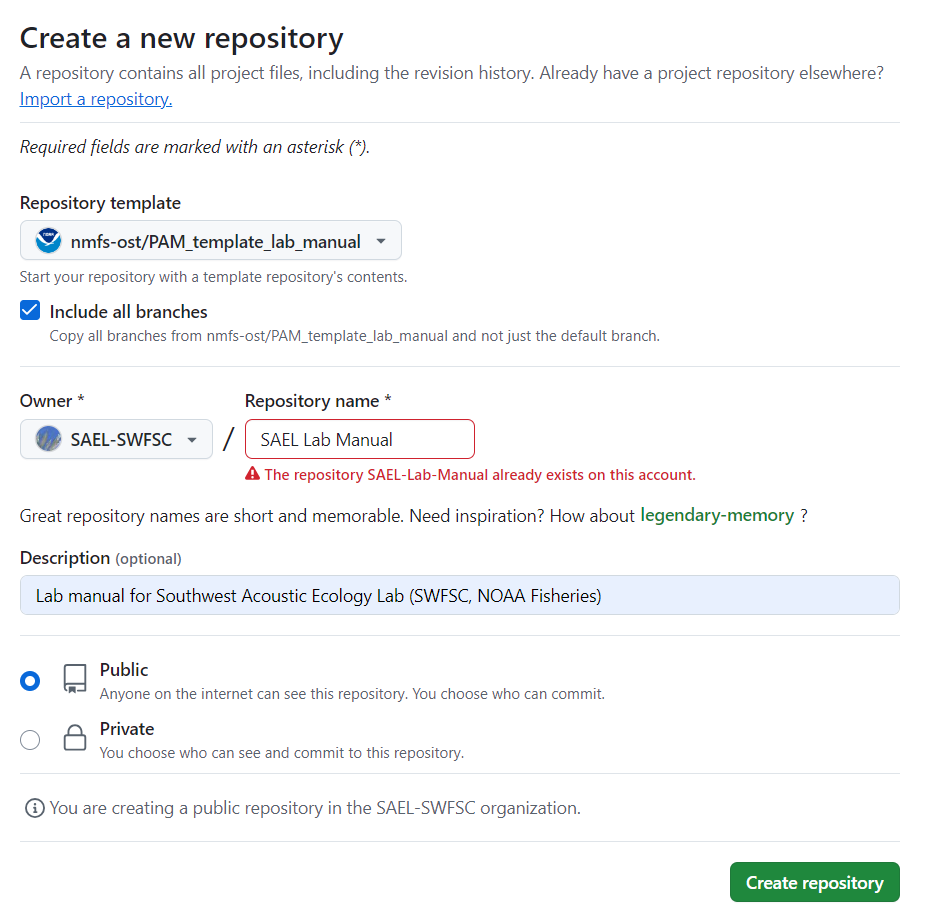
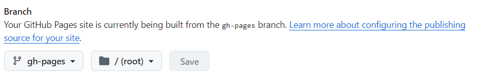
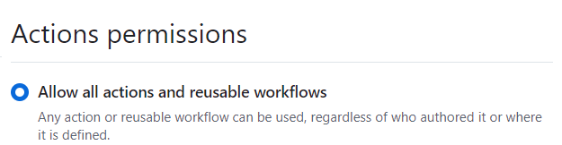
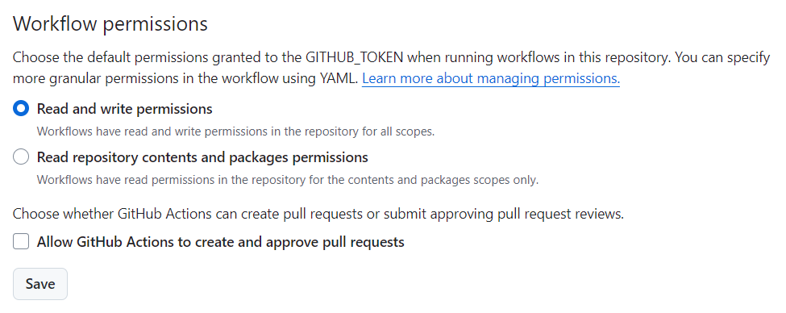
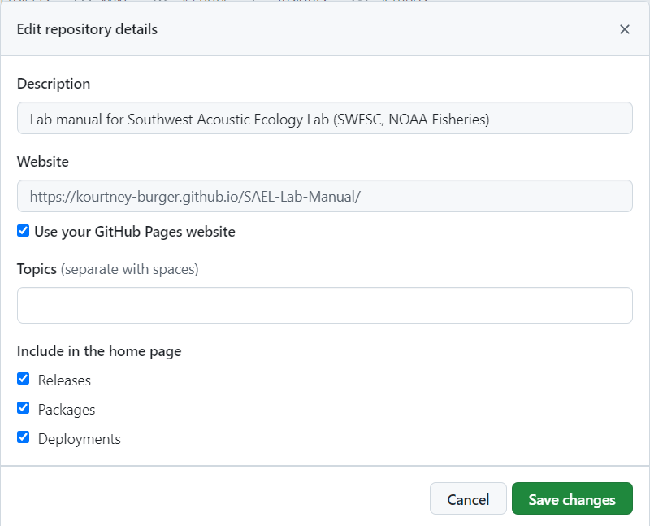

## Fisheries of the United States Report

The Fisheries of the United States report is an annual yearbook of fisheries statistics that has been reported in various forms since 1881.

More information about the current edition of the report can be found here: https://www.fisheries.noaa.gov/national/sustainable-fisheries/fisheries-united-states#us-seafood-consumption-and-import-reliance
Downloadable PDFs can be found here:
https://www.fisheries.noaa.gov/resource/document/fisheries-united-states-reports

## Required Pages

Table of Contents
-   Introduction

-   [ Commercial Fisheries ] (https://nmfs-ost.github.io/PAM_template_lab_manual/content/Hardware.html)
-   [ Recreational Fisheries ] (https://nmfs-ost.github.io/PAM_template_lab_manual/content/Software.html)
-   [ Processed Products ] ()
-   [ Aquaculture ] ()
-   [ Foreign Trade ] ()
-   [ Per Capita Consumption ] ()

-   [Analysis Methods] https://nmfs-ost.github.io/PAM_template_lab_manual/content/AnalysisMethods.html)
-   [Reporting](https://nmfs-ost.github.io/PAM_template_lab_manual/content/Reporting.html)

-   [Lab Management](https://nmfs-ost.github.io/PAM_template_lab_manual/content/LabManagement.html)
-   [Field Methods](https://nmfs-ost.github.io/PAM_template_lab_manual/content/FieldMethods.html)
-   [Data Management](https://nmfs-ost.github.io/PAM_template_lab_manual/content/DataManagement.html)

## Optional Pages

Here are some more ideas for pages to include in your lab manual. These are optional and will not be linked to the main National PAM Repo, but they may be helpful for your team

-   [Shared values/lab culture](https://nmfs-ost.github.io/PAM_template_lab_manual/content/SharedValues.html)
-   [Onboarding](https://nmfs-ost.github.io/PAM_template_lab_manual/content/Onboarding.html)
-   [Offboarding](https://nmfs-ost.github.io/PAM_template_lab_manual/content/Offboarding.html)
-   [Field Methods](https://nmfs-ost.github.io/PAM_template_lab_manual/content/FieldMethods.html)
-   [Open Science](https://nmfs-ost.github.io/PAM_template_lab_manual/content/OpenScience.html)
-   [Publications/Presentations](https://nmfs-ost.github.io/PAM_template_lab_manual/content/PublicationsPresentations.html)
-   [Resources](https://nmfs-ost.github.io/PAM_template_lab_manual/content/Resources.html)

## How To Use This Template

This template will create a Quarto website that each lab can copy and edit with their own lab information. Follow the steps below to copy this template to your lab's GitHub

1.  Open [this repository on GitHub](https://github.com/nmfs-ost/PAM_template_lab_manual)

2.  Click on the 'Use this template' button in the top right, select 'Create new repository'

    

3.  Edit repository settings

    -   Select the 'Include all branches' option

    -   Select your lab organization or yourself as the owner and set the repository name to 'Lab name Lab Manual'

    -   Make description "Lab manual for 'insert lab name and FMC'"

    -   Make the repo public

        

4.  Click create repository

5.  Turn on GitHub pages under Settings-\>Pages. You will set pages to be made from the gh-pages branch and root directory

    

6.  Update 'Actions' settings

    -   Under Settings -\> Actions -\> General -\> Actions permissions select 'Allow all actions and reusable workflows'. Select save

        {width="323"}

    -   Under Settings -\> Actions -\> General -\> Workflow permissions select 'Read and write permissions'

        

        ::: callout-important
        ## Note: Both of these settings may already be selected but you have to click save for both
        :::

7.  Return to the main page of the repo to edit your website

    -   Click on 'Code' in the top left

    -   Click on the settings button next to the 'About' section on the right side of the repository

    -   Select 'Use your GitHub Pages website'. This should autopopulate the website

    -   Select 'Save Changes'

        

8.  Your lab manual is now created! Go [here](https://sael-swfsc.github.io/OpenScience/content/labManual.html) for more information on building your lab manual.

## Example Manuals

Here are two lab manuals to pull inspiration from

-   [SWFSC Southwest Acoustic Ecology Lab Manual](https://sael-swfsc.github.io/SAEL-lab-manual/content/media.html)
-   [Faylab Manual](https://thefaylab.github.io/lab-manual/)
-   [SWFSC Glider Lab Manual](https://swfsc.github.io/glider-lab-manual/)
